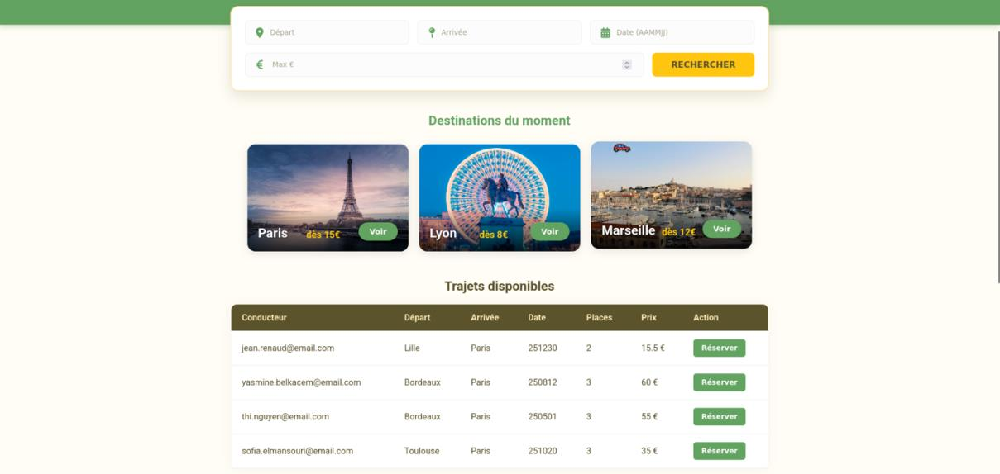
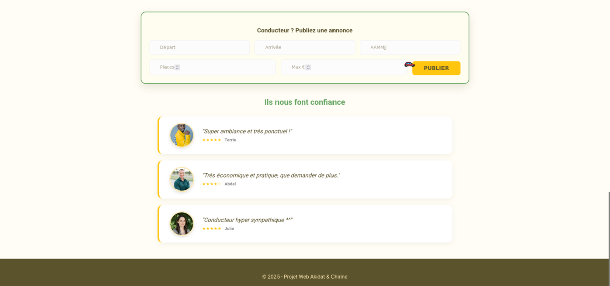

# ACHIDRIVE — site de covoiturage

Site de covoiturage en **PHP** et **MySQL** : connexion des membres, recherche de trajets multicritères, réservation et publication d'annonces.

Projet de programmation web réalisé en binôme dans le cadre du Master Informatique (parcours ICo) à l'Université de Montpellier (2025), puis **repris après le cours pour corriger ses failles de sécurité** (voir plus bas).

<p align="center">
  
</p>

## Fonctionnalités

- **Connexion / déconnexion** des membres, avec session PHP. Le prénom du membre s'affiche une fois connecté.
- **Recherche de trajets** par ville de départ, ville d'arrivée, date et prix maximum. Seuls les trajets à venir avec des places libres sont affichés.
- **Destinations du moment** : un clic sur « Voir » remplit automatiquement le champ Arrivée.
- **Réservation** d'un trajet : crée une ligne dans `Transports` et retire une place dans `Propositions`, dans une seule transaction.
- **Publication** d'un trajet par un conducteur, avec contrôle de la date (pas de date passée), du nombre de places et du prix.

<p align="center">
  
</p>

*Captures de la version rendue en cours ; l'interface n'a pas changé.*

## Base de données

Trois tables liées par des clés étrangères ([`database/achidrive.sql`](database/achidrive.sql)) :

| Table | Rôle |
|---|---|
| `Internautes` | membres (e-mail en clé primaire, mot de passe haché) |
| `Propositions` | trajets proposés par un conducteur (villes, date, places, prix) |
| `Transports` | réservations : quel passager a réservé quel trajet (une seule fois par trajet) |

Toutes les personnes du jeu de données sont fictives.

## Ce qui a été amélioré après le cours

| Problème dans la version de cours | Correction |
|---|---|
| Identifiants de la base écrits dans le code | Déplacés dans `config.php`, qui n'est pas publié (modèle : `config.example.php`) |
| Requêtes SQL construites en collant les saisies de l'utilisateur : **injection SQL** possible, y compris pour se connecter sans mot de passe | **Requêtes préparées avec paramètres** (PDO) partout |
| Données affichées telles quelles : **faille XSS** (un nom de ville piégé pouvait exécuter du JavaScript) | Tout affichage passe par `htmlspecialchars` |
| On pouvait réserver un trajet complet, ou le même trajet plusieurs fois | Vérification des places restantes, contrainte d'unicité, transaction |
| Saisies non vérifiées côté serveur | Contrôle du format de date, du nombre de places et du prix |

Pistes restantes : hacher les mots de passe avec `password_hash` plutôt que `SHA2` sans sel, et ajouter un jeton CSRF aux formulaires. Le format de date `AAMMJJ` est celui imposé par le sujet.

## Lancer le projet en local

Prérequis : PHP 8 avec l'extension `pdo_mysql`, et MySQL ou MariaDB.

1. Créer une base, par exemple `achidrive`, puis importer le schéma et les données :
   ```bash
   mysql -u root -p achidrive < database/achidrive.sql
   ```
2. Copier `config.example.php` en `config.php` et y renseigner vos identifiants MySQL.
3. Lancer le serveur PHP intégré depuis le dossier du projet :
   ```bash
   php -S localhost:8000
   ```
4. Ouvrir http://localhost:8000 et se connecter avec le compte de démonstration :
   - e-mail : `demo@achidrive.fr`
   - mot de passe : `demo1234`

## Structure

| Fichier | Contenu |
|---|---|
| `index.php` | toute l'application : traitements PHP en haut, page HTML en bas |
| `style.css` | mise en forme (variables CSS, Flexbox, animations) |
| `config.example.php` | modèle de configuration de la base |
| `database/achidrive.sql` | création des tables et données de démonstration |

## Équipe

- Chirine El Aidouni
- Akidat Moussa-Nizar
